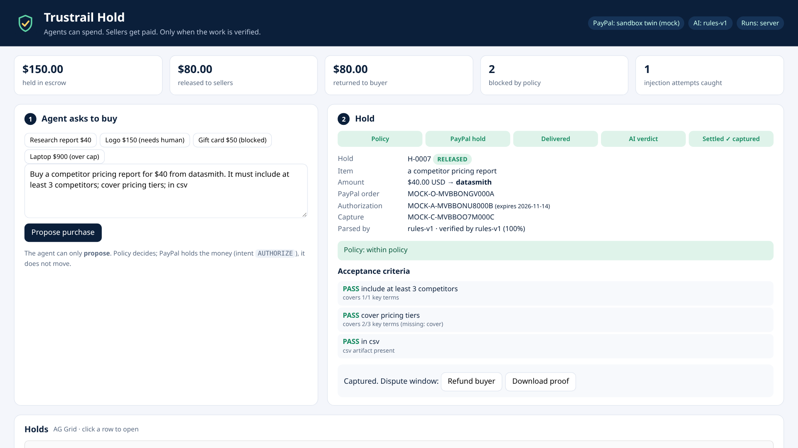

# Trustrail Hold

**AI-verified escrow for agent purchases, built on PayPal.**
Your AI agent can spend money. A seller only gets paid once an AI verifier confirms the work matches what was ordered. Until then PayPal holds the funds as an *authorization*, so no money moves.

▶ **Live demo (runs in your browser, no install):** https://northstar-trustrail.github.io/trustrail-hold/
▶ **Video (under 3 min):** _YouTube link in the Devpost submission_



## The problem
Agents that buy things (research, design, data, API calls, freelance work) leave you two bad options:
- give the agent a card and trust both the agent and the seller, or
- approve every purchase by hand, which defeats the point of having an agent.

Paying up front is also unsafe when the counterparty is another bot. Most marketplaces have no way to say "pay on verified delivery".

## How it works
```
 agent: "buy X for $40 from S. It must ..."         (natural language, or via MCP)
   │
   ▼  AI intent parser → { item, amount, seller, acceptance criteria[] }
 POLICY  per-purchase cap · daily cap · blocked categories · seller allowlist · human-approval threshold
   │ allow                 │ needs_human → operator approves      │ deny → logged, nothing created
   ▼
 PayPal Orders v2  intent=AUTHORIZE  → buyer approves on PayPal → POST /orders/{id}/authorize
   │   funds HELD (authorization, up to 29 days), not captured
   ▼
 seller submits delivery evidence (text + artifacts)
   ▼  AI verifier: one verdict per criterion; prompt-injection tripwire
 release → POST /v2/payments/authorizations/{id}/capture      (seller paid)
 refund  → POST /v2/payments/authorizations/{id}/void         (buyer never charged)
 escalate→ human decides (partial match, or seller tried to instruct the verifier)
 later dispute → POST /v2/payments/captures/{id}/refund
 deadline passed with no delivery → automatic void (sweeper)
   ▼
 every step → SHA-256 hash-chained receipt  =  portable proof-of-payment
```

### Safety built in
- **The agent can never pay a seller directly.** Over MCP it can only `propose_purchase`, `submit_delivery`, `get_hold`, `list_holds` and `get_proof`. Human approval, escalation and refunds are *not* exposed to agents.
- **Seller evidence is untrusted input.** The seller gets paid on release, so it has every reason to talk the verifier into "release". Evidence is fenced as untrusted in the LLM prompt, and a deterministic injection tripwire runs separately. If the tripwire fires, the hold escalates **even when the model says release**. There's a test for this.
- **Idempotent PayPal calls.** Every REST call sends a `PayPal-Request-Id`, so a retry can't double-capture.
- **Tamper-evident ledger.** Edit any past receipt and `Ledger.verify` fails.

## PayPal integration
| Step | API |
|---|---|
| Auth | `POST /v1/oauth2/token` (client credentials, token cached) |
| Open hold | `POST /v2/checkout/orders` with `intent: AUTHORIZE`, `payment_source.paypal.experience_context` (return/cancel URL) |
| Buyer approval | PayPal `payer-action` link → `/paypal/return` |
| Place hold | `POST /v2/checkout/orders/{id}/authorize` |
| Release | `POST /v2/payments/authorizations/{id}/capture` (`final_capture`, `invoice_id`) |
| Refund before capture | `POST /v2/payments/authorizations/{id}/void` |
| Refund after capture | `POST /v2/payments/captures/{id}/refund` |

`src/paypal/rest.js` is the real sandbox adapter. `src/paypal/mock.js` is an in-memory *sandbox twin* that enforces PayPal's state rules (no authorize before approval, no capture after void, no double capture). Both implement the same interface, so the hosted demo and the tests run without credentials.

## AI integration
- `LlmBrain` (`src/ai/llm.js`) works with **any OpenAI-compatible endpoint**: OpenAI, xAI, Groq, OpenRouter, or local Ollama/LM Studio. It parses natural-language purchase requests into structured intents with checkable acceptance criteria, then judges delivery evidence one criterion at a time, returning JSON with a reason for each.
- `RuleBrain` (`src/ai/rules.js`) is a deterministic offline verifier: counts, formats and key-term coverage. It powers the in-browser demo and the tests, and acts as the fallback when no model is configured.
- `src/ai/guard.js` is the prompt-injection tripwire.

## AG Grid
The dashboard uses **AG Grid Community** (MIT, vendored at `web/vendor/`) for two live grids:
- a **holds grid**: state pill renderer, money formatting, sort/filter on every column, row highlight when an injection was caught, click to open a row;
- a **proof-of-payment ledger grid**: every receipt with its prev/hash link, color-coded event types, one-click **Verify chain**, and **Export CSV** for auditors.

## MCP server (any agent can use it)
```jsonc
// e.g. Claude Desktop / Cursor mcp.json
{ "mcpServers": { "trustrail-hold": { "command": "node", "args": ["/path/to/trustrail-hold/src/mcp.js"],
  "env": { "TRUSTRAIL_URL": "http://localhost:8787" } } } }
```
If `TRUSTRAIL_URL` is set, the MCP server proxies to the running dashboard, so you watch the agent's holds appear live. Without it, it runs an in-process engine.

## Run it
Requires Node 20+. There are **no npm dependencies**.
```bash
git clone https://github.com/northstar-trustrail/trustrail-hold && cd trustrail-hold
npm test                 # 12 tests: escrow flows, policy, injection, ledger tamper, PayPal REST contract, MCP stdio
npm start                # http://localhost:8787 (mock PayPal + rule verifier)
npm run demo:cli         # the whole flow in the terminal
```
### With the real PayPal sandbox
1. Log in at https://developer.paypal.com/dashboard/applications/sandbox, open the default app, and copy its **Client ID** and **Secret**.
2. Under *Testing Tools → Sandbox Accounts*, use the auto-created **personal** account to approve holds.
```bash
export PAYPAL_CLIENT_ID=...  PAYPAL_CLIENT_SECRET=...
npm start   # badge shows "PayPal: sandbox REST"; "Approve hold on PayPal sandbox →" opens the real checkout
```
### With an LLM
```bash
export AI_BASE_URL=https://api.openai.com/v1 AI_API_KEY=... AI_MODEL=gpt-4o-mini
# or local: AI_BASE_URL=http://localhost:11434/v1 AI_MODEL=llama3.1
```
### Policy
Set `TRUSTRAIL_POLICY='{"perPurchaseLimit":200,"dailyLimit":500,"humanApprovalAbove":100,"allowedMerchants":["datasmith"]}'`.

## Layout
```
src/core/escrow.js    state machine: propose → hold → deliver → verify → capture|void|escalate → refund, sweep, proof
src/core/policy.js    guardrails      src/core/ledger.js  hash-chained receipts
src/paypal/rest.js    PayPal REST     src/paypal/mock.js  sandbox twin
src/ai/llm.js         LLM brain       src/ai/rules.js     offline brain     src/ai/guard.js  injection tripwire
src/server.js         HTTP API + PayPal return URL     src/mcp.js  MCP stdio server
web/                  dashboard (AG Grid), also built to GitHub Pages (engine runs in-browser)
```

## Status / honesty notes
- The hosted demo uses the mock sandbox twin and the rule-based verifier, so it works with zero keys. The real sandbox adapter is covered by contract tests that check the exact Orders v2 / Payments v2 requests. Run with sandbox credentials to see real PayPal order, authorization and capture IDs.
- Sandbox only. Never point this at live credentials without adding persistence and webhooks (`PAYMENT.AUTHORIZATION.VOIDED`, `PAYMENT.CAPTURE.COMPLETED`).

MIT © Northstar Trustrail
